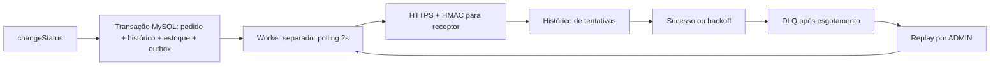

# RFC — Webhooks de notificação de pedidos

## Metadados

- Autor: Adriano Lima, com assistência do Codex.
- Status: proposta para revisão; decisões de arquitetura confirmadas na reunião registradas em ADRs. Não representa aprovação de implementação.
- Data do documento: 2026-10-14. Data calendário da reunião não informada.
- Revisores: Larissa (Tech Lead), Marcos (PM), Bruno (Pedidos), Diego (Plataforma), Sofia (Segurança).
- Documentos associados: [PRD](PRD.md), [FDD](FDD.md), [Tracker](TRACKER.md).

## Resumo executivo (TL;DR)

**RFC-PROP-01.** Propomos notificações outbound de mudanças de status por outbox no
MySQL, gravada na mesma transação do pedido. Um processo Node separado consome a
outbox a cada 2s, assina o corpo com HMAC-SHA256 e envia via HTTPS. Entrega admite
duplicatas identificáveis por X-Event-Id. Falhas recebem backoff e depois DLQ com
replay administrativo auditado. CRUD, filtros e histórico ficam disponíveis por API.
O FDD concentra os contratos; este RFC solicita revisão das lacunas abaixo.

## Contexto e problema

**RFC-CTX-01.** Atlas Comercial, MaxDistribuição e Nova Cargo consultam GET /orders
periodicamente. Isso torna a integração lenta e cara; há risco de perda da Atlas.
A expectativa declarada é notificação em menos de 10s. Não é um SLA com percentil,
carga ou disponibilidade definidos. A transcrição cita fim do trimestre e depois
fim de novembro; Marcos deve confirmar a data comercial, sem inferir ano.

## Proposta técnica

**RFC-PROP-02.** A API continua responsável pela transação de changeStatus. A função
publishWebhookEvent recebe o TransactionClient, encontra endpoints ativos do customer
que assinam o novo status e registra snapshots. Sem assinantes, não cria outbox.
O worker usa o mesmo banco, com PrismaClient próprio por processo, sem chamar HTTP
na transação de negócio. Mantemos o padrão modular, erros AppError e logger Pino.

**RFC-PROP-03.** A configuração tem secret por endpoint, rotação com sobreposição
por 24h e filtro de status. JWT autentica usuários operadores; customer é informado
na API e não derivado do token. Replay requer ADMIN via requireRole. A reunião
permite qualquer role autenticada no CRUD, sem definir vínculo usuário–customer.
Esse limite deve ser visível na revisão de segurança.

## Alternativas consideradas

| ID | Alternativa real da reunião | Trade-off e motivo do descarte |
|---|---|---|
| RFC-ALT-01 | HTTP síncrono em changeStatus | Menos componentes, mas receptor lento bloqueia transação e indisponibilidade externa afeta o pedido. |
| RFC-ALT-02 | Redis Streams | Fila dedicada, mas exige infraestrutura adicional ao MySQL para um time pequeno. |
| RFC-ALT-03 | Trigger para notificar worker | Intenção de menor latência, mas MySQL não oferece notificação externa equivalente a NOTIFY/LISTEN nesse desenho. |
| RFC-ALT-04 | Exactly-once | Evitaria deduplicação no cliente, mas exigiria coordenação bilateral e maior complexidade. |

## Questões em aberto

As quatro primeiras precisam de resposta antes de fechar o respectivo detalhe do FDD.
As duas seguintes foram explicitamente adiadas na reunião.

| ID | Questão e origem | Encaminhamento proposto para revisão |
|---|---|---|
| RFC-OPEN-01 | “5 tentativas” e cinco intervalos 1m/5m/30m/2h/12h são incompatíveis se incluirmos a primeira chamada no total. | Larissa/Diego devem escolher: 5 chamadas totais e redefinir esperas, ou chamada inicial + 5 retries (6 chamadas). Não codificar a contagem sem confirmação. |
| RFC-OPEN-02 | Ordem por order_id foi afirmada para single-worker, sem regra para retry ou empate de created_at. | Diego/Bruno devem validar bloqueio de sucessores do mesmo pedido enquanto o predecessor aguarda retry e definir desempate; avaliar custo de atraso. |
| RFC-OPEN-03 | Rotação define 24h com duas chaves válidas, sem wire format, encoding ou modo de transição das assinaturas. | Sofia deve aprovar protocolo; proposta no FDD usa nova chave no envio e ambas no verificador do cliente. Migração do receptor precisa ser coordenada. |
| RFC-OPEN-04 | Crash após envio e antes de persistir sucesso pode causar duplicata; falta recuperação de linhas processando. | Diego deve validar recuperação no startup com garantia operacional de um único worker. |
| RFC-OPEN-05 | Rate limiting de saída foi deixado para “observar e decidir depois”. | Observar backlog e resposta dos receptores; sem limiter nesta fase. |
| RFC-OPEN-06 | Arquivamento de entregues após “30 dias ou assim” ficou fora do escopo. | Definir retenção e operação em evolução posterior; não tratar 30 dias como política aprovada. |
| RFC-OPEN-07 | CRUD exige JWT, mas sem modelo de autorização por customer. | Sofia/Marcos devem validar o uso por usuários operadores; não documentar isolamento por tenant inexistente. |
| RFC-OPEN-08 | Respostas HTTP de sucesso/falha, batch, timeout de persistência e semântica de exclusão pendente não foram fechados. | Revisar propostas do FDD antes da implementação e dimensionar carga sem inventar SLA. |

## Impacto e riscos

**RFC-RISK-01.** Outbox adiciona carga e armazenamento ao MySQL. Batches pequenos e
índices ajudam; tamanho do batch e retenção ainda precisam de definição. Single-worker
simplifica operação, mas backlog ou um receptor lento podem ultrapassar 10s; medir
latência fim a fim em cenário representativo antes de confirmar atendimento.

**RFC-RISK-02.** Duplicatas exigem deduplicação pelo cliente. Secrets, URL externa e
replay exigem revisão de Sofia, incluindo armazenamento de chaves, destino de rede,
redação de logs e autorização. A reunião reservou dois dias úteis para revisão de
segurança, incluídos na estimativa de três sprints; não são datas de entrega já validadas.

## Decisões relacionadas

- [ADR-001 — Outbox no MySQL](adrs/ADR-001-outbox-no-mysql.md)
- [ADR-002 — Retry e DLQ](adrs/ADR-002-retry-com-backoff-e-dlq.md)
- [ADR-003 — HMAC e rotação](adrs/ADR-003-hmac-e-rotacao-de-secret.md)
- [ADR-004 — At-least-once](adrs/ADR-004-at-least-once-e-event-id.md)
- [ADR-005 — Worker separado](adrs/ADR-005-worker-separado-com-polling.md)
- [ADR-006 — Padrões do OMS](adrs/ADR-006-reuso-dos-padroes-do-oms.md)
- [ADR-007 — Snapshot](adrs/ADR-007-snapshot-do-payload-na-outbox.md)
